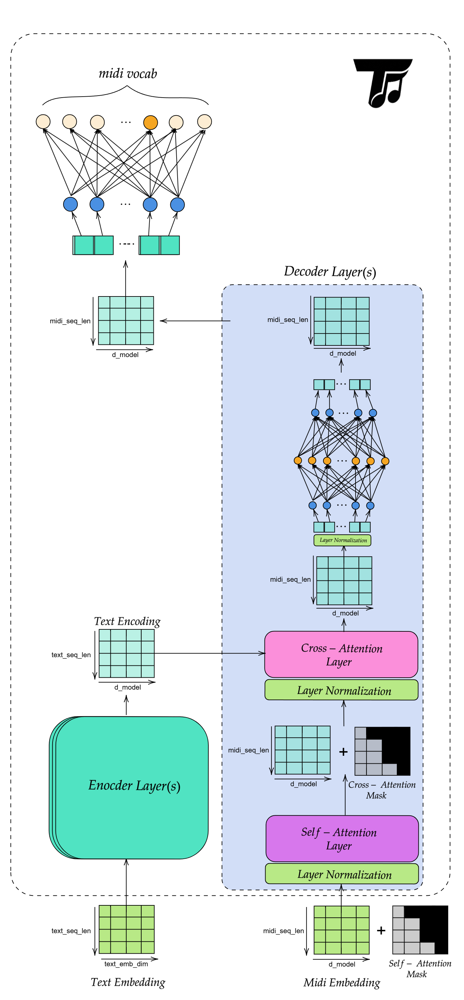

# Tune ML

<div align="center">
  

  
  
</div>

Tune ML is a deep-learning toolkit for audio processing, audio classification, and music generation. The repository combines reusable model implementations, training utilities, datasets, and notebooks for experimentation.

## Requirements

- Python 3.10 or newer
- A working PyTorch installation for your CPU or CUDA environment
- The dependencies declared in [`pyproject.toml`](pyproject.toml)

## Installation

Install the project with Poetry:

```bash
poetry install
```

To activate Poetry's virtual environment, run `poetry shell` when that command is available in your Poetry installation. Alternatively, install the package in editable mode with pip:

```bash
pip install -e .
```

The project also includes a Sphinx documentation site. Its source files are in [`docs/source/`](docs/source/).

## Repository Layout

- [`tuneml/models/`](tuneml/models/) contains model implementations, including the MiniVGG classifier and MIDI transformers.
- [`tuneml/data/`](tuneml/data/) and [`tuneml/tokenizers/`](tuneml/tokenizers/) contain data-processing and tokenization code.
- [`tuneml/trainers/`](tuneml/trainers/) contains training utilities.
- [`tuneml/modules/`](tuneml/modules/) provides higher-level inference modules.
- [`notebooks/`](notebooks/) contains experiments for audio codecs, MIDI generation, text-to-MIDI, and audio classification.

## Models

### Classification models

<details>
<summary><strong>MiniVGG audio classifier</strong></summary>

MiniVGG is a compact VGG-style convolutional neural network for classifying audio. It expects a single-channel 128 × 128 spectrogram. The [`AudioClassifier`](tuneml/modules/classifier/AudioClassifier.py) inference module prepares audio as follows:

1. Audio is loaded or received as a waveform and resampled to 22,050 Hz.
2. Multi-channel audio is converted to mono.
3. A 128-bin mel spectrogram is computed with an FFT size of 2,048 and a hop length of 512.
4. The spectrogram is converted to decibels and padded to 128 × 128.
5. MiniVGG applies three convolutional blocks, each with two convolutions, batch normalization, ReLU activation, and max pooling.
6. The final feature representation is classified into the labels stored in the model checkpoint.

The classifier returns either the most likely `(class_name, probability)` pair or the top `k` predictions. A checkpoint should contain `model_state_dict` (or `state_dict`) and, preferably, a `class_to_idx` mapping.

```python
from tuneml.modules.classifier import AudioClassifier

classifier = AudioClassifier("weights/best_mini_vgg.pth", device="cpu")
prediction = classifier.predict("path/to/audio.wav")
print(prediction)
```

See the [VGG audio classifier notebook](notebooks/vgg_audio_classifier.ipynb) for training and evaluation experiments.

</details>

### Generation models

<details>
<summary><strong>MIDI Transformer</strong></summary>

The MIDI Transformer generates MIDI token sequences conditioned on text. Its implementation is described below.

## Transformer module

This module contains the core transformer blocks used by the MIDI generation stack.

### `Transformer`

The [`Transformer.py`](tuneml/models/transformer/Transformer.py) module provides the shared building blocks used by the decoder and other transformer-style models.

#### `MultiHeadAttention`

Multi-head attention projects queries, keys, and values into multiple heads, applies scaled dot-product attention in each head, then concatenates the result back to `d_model`.

##### Inputs

- `q`: `(batch_size, seq_len_q, d_model)`
- `k`: `(batch_size, seq_len_k, d_model)`
- `v`: `(batch_size, seq_len_v, d_model)`
- `mask`: optional boolean mask where `True` entries are masked out

##### Output

- `(batch_size, seq_len_q, d_model)`

> [!NOTE]
> The attention block requires `d_model` to be divisible by `num_heads`.
> It is used both for masked self-attention and for cross-attention.

#### `PointwiseFFN`

The feed-forward block applies a position-wise two-layer MLP to each token representation independently.

##### Inputs

- `x`: `(batch_size, seq_len, d_model)`

##### Output

- `(batch_size, seq_len, d_model)`

> [!NOTE]
> The intermediate size is `d_ff`.
> This block expands features, applies `ReLU`, and projects back to `d_model`.

### `MidiTransformer`

[`MidiTransformer.py`](MidiTransformer.py) defines the text-conditioned encoder-decoder model used for MIDI token generation.

#### Purpose

`MidiTransformer` learns a distribution over the next MIDI token at each decoder position while conditioning on encoded text.

#### Architecture

The diagram below shows the flow used by the conditional MIDI transformer model:

1. Text tokens are embedded and encoded into a contextual memory tensor.
2. MIDI tokens are embedded and passed through masked self-attention.
3. The decoder cross-attends to the encoded text memory.
4. A final linear layer projects decoder states to MIDI vocabulary logits.

<div align="center">
  
</div>

#### Main components

- **Text embedding**: converts text token IDs to `d_model` vectors.
- **Text positional encoding**: injects absolute order information into the text sequence.
- **Text encoder**: produces a contextual memory tensor from the text sequence.
- **MIDI embedding**: converts MIDI token IDs to `d_model` vectors.
- **MIDI positional encoding**: injects order information into the MIDI sequence.
- **Transformer decoder**: applies masked self-attention over MIDI tokens and cross-attention over text memory.
- **Final projection**: maps each decoder state to MIDI vocabulary logits.

#### Methods

##### `tokenize_text(text, device="cpu")`

Tokenizes raw text using the Flan-T5 tokenizer and returns token IDs together with a padding mask.

Returns:

- `text_tokens`: `(batch_size, text_seq_len)`
- `text_padding_mask`: `(batch_size, text_seq_len)` with `True` at padded positions

##### `generate_causal_mask(seq_len, device=None)`

Creates an upper-triangular boolean mask for autoregressive decoding.

Returns:

- `(seq_len, seq_len)` boolean mask with `True` above the diagonal

##### `encode_text(text_tokens, text_padding_mask=None)`

Embeds text tokens, adds positional encoding, applies dropout, and runs the encoder.

Returns:

- `memory`: `(batch_size, text_seq_len, d_model)`

##### `forward(text_tokens, midi_tokens, tgt_mask=None, text_padding_mask=None)`

Runs the full conditional forward pass.

Flow:

1. Encode text into `memory`.
2. Embed MIDI tokens and add positional encoding.
3. Decode with masked self-attention and text cross-attention.
4. Project decoder states to MIDI vocabulary logits.

Returns:

- `(batch_size, midi_seq_len, midi_vocab_size)`

##### `generate(text_tokens, start_token_id, max_len=512, temperature=1.0, top_k=None, text_padding_mask=None, device="cpu")`

Autoregressively samples MIDI tokens one step at a time.

How it works:

1. Encode the text once.
2. Seed generation with the start token.
3. At each step, decode the current prefix.
4. Use the last position's logits to sample the next token.
5. Append the token and repeat until `max_len`.

Returns:

- `(batch_size, generated_seq_len)`

#### Samples

- [Midi transformer samples](https://mazens0liman.github.io/TuneML/samples.html#)

</details>
