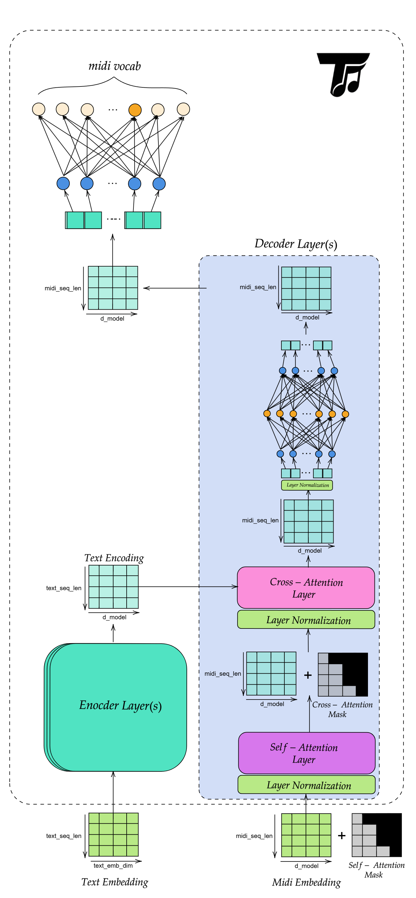

Models
======

This section describes the primary model families in TuneML.

Classification Models
---------------------

MiniVGG Audio Classifier
~~~~~~~~~~~~~~~~~~~~~~~~

MiniVGG (``tuneml/models/vgg/MiniVGG.py``) is a compact VGG-style convolutional
neural network for audio classification. It expects a single-channel,
128 × 128 spectrogram.

The :class:`~tuneml.modules.classifier.AudioClassifier` inference module
prepares audio as follows:

1. Load or receive a waveform and resample it to 22,050 Hz.
2. Convert multi-channel audio to mono.
3. Compute a 128-bin mel spectrogram (FFT size 2,048, hop length 512).
4. Convert the spectrogram to decibels and pad it to 128 × 128.
5. Pass it through three convolutional blocks, each with two convolutions,
   batch normalization, ReLU activation, and max pooling.
6. Classify the final features into the labels stored in the checkpoint.

The classifier returns either the most likely ``(class_name, probability)``
pair or the top ``k`` predictions.

.. note::

   A checkpoint should contain ``model_state_dict`` (or ``state_dict``) and,
   preferably, a ``class_to_idx`` mapping.

.. code-block:: python

   from tuneml.modules.classifier import AudioClassifier

   classifier = AudioClassifier("weights/best_mini_vgg.pth", device="cpu")
   prediction = classifier.predict("path/to/audio.wav")
   print(prediction)

Generation Models
-----------------

The transformer stack includes custom multi-head attention and feed-forward
blocks, a text-conditioned MIDI generator, and a GPT-style MIDI model.

- Shared blocks: ``tuneml/models/transformer/Transformer.py``
- Text-conditioned generator: ``tuneml/models/transformer/MidiTransformer.py``
- GPT-style MIDI model: ``tuneml/models/transformer/MidiGPT.py``

Transformer Building Blocks
~~~~~~~~~~~~~~~~~~~~~~~~~~~

``MultiHeadAttention``
   Projects queries, keys, and values into multiple heads, applies scaled
   dot-product attention in each head, and concatenates the result back to
   ``d_model``. It is used for both masked self-attention and cross-attention.

   .. list-table::
      :header-rows: 1
      :widths: 15 45 40

      * - Input
        - Shape
        - Notes
      * - ``q``
        - ``(batch_size, seq_len_q, d_model)``
        - Queries
      * - ``k``
        - ``(batch_size, seq_len_k, d_model)``
        - Keys
      * - ``v``
        - ``(batch_size, seq_len_v, d_model)``
        - Values
      * - ``mask``
        - optional
        - Boolean mask; ``True`` entries are masked out

   Output shape: ``(batch_size, seq_len_q, d_model)``.

   .. note::

      ``d_model`` must be divisible by ``num_heads``.

``PointwiseFFN``
   Applies a position-wise two-layer MLP to each token independently. It
   expands features to ``d_ff``, applies ReLU, and projects back to
   ``d_model``. Input and output shape: ``(batch_size, seq_len, d_model)``.

MIDI Transformer
~~~~~~~~~~~~~~~~

``MidiTransformer`` is a text-conditioned encoder-decoder model for MIDI token
generation. It learns a distribution over the next MIDI token at each decoder
position while conditioning on encoded text.

The model works in four stages:

1. Text tokens are embedded and encoded into a contextual memory tensor.
2. MIDI tokens are embedded and passed through masked self-attention.
3. The decoder cross-attends to the encoded text memory.
4. A final linear layer projects decoder states to MIDI vocabulary logits.

.. list-table:: Main components
   :header-rows: 1
   :widths: 30 70

   * - Component
     - Purpose
   * - Text embedding
     - Converts text token IDs to ``d_model`` vectors
   * - Text positional encoding
     - Injects absolute order information into the text sequence
   * - Text encoder
     - Produces a contextual memory tensor from the text sequence
   * - MIDI embedding
     - Converts MIDI token IDs to ``d_model`` vectors
   * - MIDI positional encoding
     - Injects order information into the MIDI sequence
   * - Transformer decoder
     - Applies masked self-attention over MIDI tokens and cross-attention over
       the text memory
   * - Final projection
     - Maps each decoder state to MIDI vocabulary logits

.. list-table:: Methods
   :header-rows: 1
   :widths: 35 40 25

   * - Method
     - Description
     - Returns
   * - ``tokenize_text(text, device="cpu")``
     - Tokenizes raw text with the Flan-T5 tokenizer
     - ``text_tokens`` and ``text_padding_mask``, each
       ``(batch_size, text_seq_len)``; the mask is ``True`` at padded
       positions
   * - ``generate_causal_mask(seq_len, device=None)``
     - Builds an upper-triangular mask for autoregressive decoding
     - ``(seq_len, seq_len)`` boolean mask, ``True`` above the diagonal
   * - ``encode_text(text_tokens, text_padding_mask=None)``
     - Embeds text, adds positional encoding, applies dropout, and runs the
       encoder
     - ``memory`` ``(batch_size, text_seq_len, d_model)``
   * - ``forward(text_tokens, midi_tokens, tgt_mask=None, text_padding_mask=None)``
     - Full conditional forward pass: encode text, embed MIDI, decode, and
       project to logits
     - ``(batch_size, midi_seq_len, midi_vocab_size)``
   * - ``generate(text_tokens, start_token_id, max_len=512, temperature=1.0, top_k=None, text_padding_mask=None, device="cpu")``
     - Autoregressively samples MIDI tokens
     - ``(batch_size, generated_seq_len)``

``generate`` works as follows:

1. Encode the text once.
2. Seed generation with the start token.
3. At each step, decode the current prefix.
4. Sample the next token from the last position's logits.
5. Append the token and repeat until ``max_len``.

Listen to generated examples on the :doc:`samples` page.

Training Components
-------------------

- MIDI transformer trainer: ``tuneml/trainers/MidiTransformerTrainer.py``
- MIDI GPT trainer: ``tuneml/trainers/MidiGPTTrainer.py``
- Audio classifier trainer: ``tuneml/trainers/MiniVGGTrainer.py``
